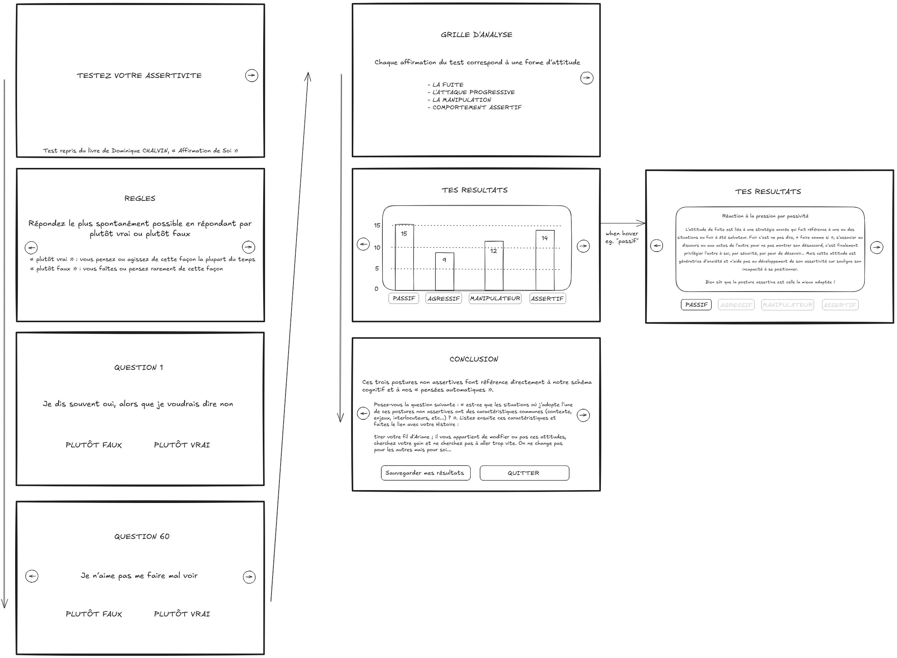
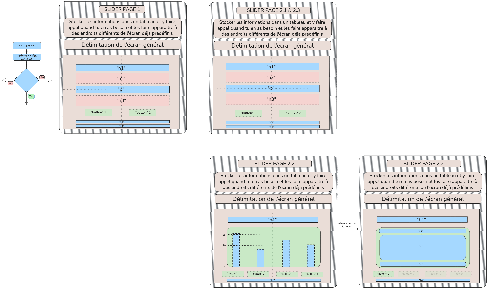

# AssertivenessProject : Auto-diagnostic d'Assertivité (🛠️en developpement🛠️)

Avant propos: C'est en soit ma première idée pour répondre au besoin d'un questionnaire fait sur papier à la base. Elle est en date du début de mon entrée dans le developpement, je dois la finaliser, mais le temps reste précieux et ça viendra quand ça viendra.


Lien vers le projet : [Assertiveness Project](https://vincentlesniak.github.io/AssertivenessProject/) (le projet est en developpement)

**AssertivenessProject** est une application web interactive permettant d'évaluer son niveau d'assertivité à travers un test d'auto-diagnostic de 60 questions.

Ce projet a pour vocation d'aider les utilisateurs à identifier leur style de communication dominant (assertif, passif, agressif ou manipulateur) afin d'améliorer leur aisance relationnelle et leur efficacité collective.

## Public cible

- **Les particuliers :** Pour le développement personnel et une meilleure connaissance de soi.
- **Les professionnels :** Pour améliorer le leadership, la gestion de conflits et la communication interpersonnelle.
- **Les entreprises :** Pour les équipes RH, les coachs ou les managers souhaitant renforcer la cohésion et le bien-être de leurs équipes.

## Fonctionnalités clés

- **Questionnaire complet :** 60 mises en situation basées sur des comportements sociaux et professionnels réels.
- **Interface intuitive :** Navigation fluide question par question.
- **Format binaire rapide :** Choix simples entre « Plutôt Vrai » et « Plutôt Faux » pour garantir la spontanéité des réponses (règle primordiale du test).
- **Analyse des résultats :** histogramme des quatre postures avec une animation (prévu en v0.3.0).

## Technologies utilisées

- **Frontend :** HTML5, CSS, JavaScript vanilla en modules ES, construit avec [Vite](https://vite.dev/).
- **Données :** les questions et les textes sont dans `src/data/` (JSON), pour faciliter la maintenance et les éventuelles traductions.
- **Qualité :** ESLint, Prettier, tests [Vitest](https://vitest.dev/), CI GitHub Actions.

## Développement

Prérequis : Node.js 22 (voir `.nvmrc`).

```bash
npm install        # installe les dépendances
npm run dev        # lance le site en local avec rechargement automatique
npm test           # lance les tests
npm run lint       # vérifie le code
npm run format     # formate le code
npm run build      # produit le site final dans dist/
```

### Arborescence

```
├─ .github/        CI, déploiement GitHub Pages, modèles d'issues et de PR
├─ docs/
│  ├─ maquettes/   maquettes Excalidraw (PNG, SVG)
│  └─ decisions/   décisions de conception
├─ src/
│  ├─ data/        questions.json, content.json
│  ├─ core/        logique pure (calcul des scores) + tests
│  ├─ ui/          affichage
│  ├─ styles/      CSS
│  └─ main.js      point d'entrée
└─ index.html
```

### Contribuer

- Une branche par tâche (`feat/…`, `fix/…`, `refactor/…`), fusionnée dans `main` par une PR avec la CI verte.
- Messages de commit au format [Conventional Commits](https://www.conventionalcommits.org/fr/) : `feat: …`, `fix: …`.
- Chaque version est listée dans [CHANGELOG.md](CHANGELOG.md).

## Maquettes




## Licence

Tous droits réservés, voir [LICENSE](LICENSE). Le questionnaire est repris du livre de Dominique Chalvin, « Affirmation de soi ».
